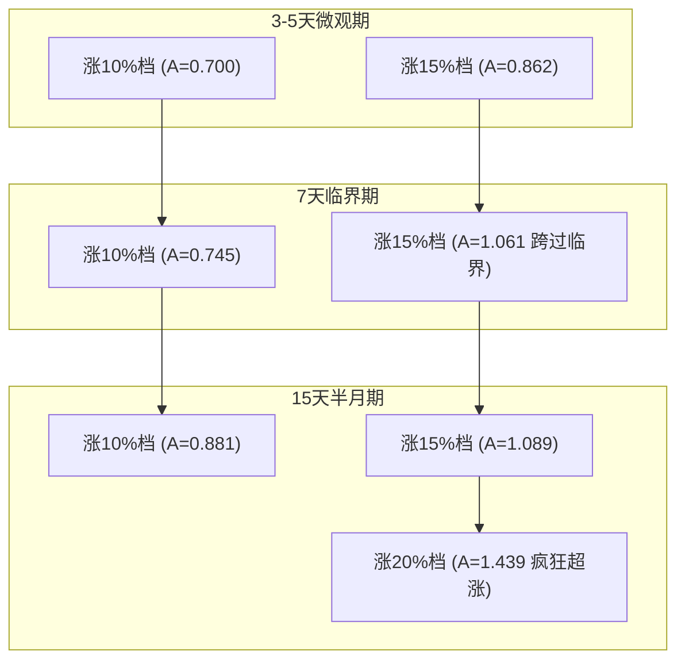

# 橡胶期现微观 3天 / 5天 / 7天 / 15天 阶梯大涨大跌期现传导机制专项报告

> **研究目标**：  
> 针对期货盘面在 **3天、5天、7天、15天** 微观与半月短窗口内，出现 **10%档 (8-12%)、15%档 (12-18%)、20%档 (≥18%)** 的剧烈暴涨与暴跌行情，单独展开深度定量计算与产业链传导机制分析。

---

## 一、 核心研究结论速览

1. **3天与5天窗口：物理调价极度粘性与防守抗跌**  
   - 在 3~5 天短窗口内，原料收购报价存在极高的物理调价粘性。  
   - **5天大跌 10% 档**：期货跌 8.54% 时，原料仅跟跌 1.61%（**$A = 0.188$**），表现出强烈的**收购价下行防守粘性**。  
   - **5天大涨 10% 档**：期货涨 9.73% 时，原料跟涨 7.56%（**$A = 0.700$**），响应敏锐度高于下行。

2. **7天窗口：15% 档触发追价临界点 ($A > 1.0$)**  
   - 当 7 天内期货累计涨幅跨过 12% 进入 15% 档（$F_{med} = +13.88\%$）时，非对称比突破 1.0 升至 **$A = 1.061$**，证明连续 7 天的剧烈暴涨会击穿加工厂观望心理。

3. **15天半月窗口：全面消化与 20% 档狂热超涨 ($A = 1.439$)**  
   - **15天 10% 档**：跟涨率升至 **88.1%**（$A = 0.881$），传导缺口缩至 $-1.06\text{pp}$，原料基本完成对中度上涨的完全消化。  
   - **15天 15% 档**：维持全面同步与略超涨（$A = 1.089$，$R_{med} = +16.19\%$）。  
   - **15天 20% 极端暴涨档**：期货大涨 21.49% 时，原料收购价出现**正反馈挤兑狂热**，原料涨幅飙升至 **$R_{med} = +37.05\%$**，非对称比达到惊人的 **$A_{med} = 1.439$**（传导缺口 $G = +12.15\text{pp}$）！

---

## 二、 3天 / 5天 / 7天 / 15天 微观传导全景对比矩阵

数据基于 2020–2026 年海南 18 个市县共同报价端点法计算，采样涵盖全部符合条件的滑动窗口：

| 窗口跨度 | 细分幅度档位 | 样本量 $n$ | 期货涨跌幅 $F_{med}$ | 原料涨跌幅 $R_{med}$ | **非对称比 $A_{med}$** | **传导缺口 $G_{med}$** | 响应斜率 $R \sim F$ | 传导特征与阶段现象 |
|---|---|---|---|---|---|---|---|---|
| **3 天** | **涨 10% 档 (8-12%)** | 2 | +10.85% | +8.06% | **0.743** | -2.79pp | - | 初步跟涨，跟涨率约 74% |
| **3 天** | **跌 10% 档 (8-12%)** | 1 | -8.14% | +2.48% | **-0.305** | +10.63pp | - | 原料逆势未跌，极度抗跌防守 |
| **3 天** | **跌 15% 档 (12-18%)** | 1 | -12.06% | -3.04% | **0.252** | +9.02pp | - | 极度抗跌，跟跌仅 25% |
| **5 天** | **涨 10% 档 (8-12%)** | 6 | +9.73% | +7.56% | **0.700** | -3.26pp | 0.002 | 跟涨滞后，缺口 3.26pp |
| **5 天** | **涨 15% 档 (12-18%)** | 2 | +12.31% | +10.58% | **0.862** | -1.73pp | - | 响应灵敏度提升至 86% |
| **5 天** | **跌 10% 档 (8-12%)** | 7 | -8.54% | -1.61% | **0.188** | +6.93pp | -1.347 | **极度防守抗跌 ($A < 0.2$)** |
| **7 天** | **涨 10% 档 (8-12%)** | 13 | +9.37% | +7.01% | **0.745** | -2.40pp | -0.342 | 稳健响应约 75% |
| **7 天** | **涨 15% 档 (12-18%)** | 7 | +13.88% | +12.78% | **1.061** | **+0.74pp** | 2.525 | **触发追涨爆发 ($A > 1.0$)** |
| **7 天** | **跌 10% 档 (8-12%)** | 11 | -9.55% | -6.10% | **0.682** | +2.84pp | 6.041 | 跟跌恢复至 68% |
| **15 天** | **涨 10% 档 (8-12%)** | 38 | +9.26% | +8.93% | **0.881** | -1.06pp | 1.083 | **基本完全消化 (跟涨率 88%)** |
| **15 天** | **涨 15% 档 (12-18%)** | 14 | +13.70% | +16.19% | **1.089** | **+1.43pp** | 1.562 | **稳健超涨跟进** |
| **15 天** | **涨 20% 档 (≥18%)** | 9 | +21.49% | +37.05% | **1.439** | **+12.15pp** | 1.396 | **极度狂热超涨 ($R$ 达 37%)** |
| **15 天** | **跌 10% 档 (8-12%)** | 28 | -9.25% | -4.27% | **0.493** | +4.50pp | -0.816 | 维持约 50% 下行缓冲 |
| **15 天** | **跌 15% 档 (12-18%)** | 1 | -14.51% | -15.67% | **1.079** | -1.15pp | - | 彻底瓦解，完全同步/略补跌 |

---

## 三、 涨幅阶梯 (10%档 vs 15%档 vs 20%档) 演变机制

### 1. 涨 10% 档 (8% ~ 12%)：时间的逐步消化过程
- **3天 (A=0.743)** $\to$ **5天 (A=0.700)** $\to$ **7天 (A=0.745)** $\to$ **15天 (A=0.881)**。
- 10% 幅度下的跟涨率随时间稳定上升，从前 5 天的 70% 逐步提升到半个月时的 88%，缺口从 $-3.26\text{pp}$ 缩小到 $-1.06\text{pp}$。

### 2. 涨 15% 档 (12% ~ 18%)：7 天后的持续强劲
- **5天 (A=0.862)** $\to$ **7天 (A=1.061)** $\to$ **15天 (A=1.089)**。
- 盘面大涨 15% 时，7 天后原料完全跨过 1.0 节点，并在 15 天内保持稳健超涨（原料中位涨 16.19%）。

### 3. 涨 20% 档 (≥18%)：15 天半月窗口下的极端正反馈超涨
- 在 15 天的时间窗口内，期货大涨 21.49% 时，海南收购价飙升 **+37.05%**（$A_{med} = 1.439$，$G = +12.15\text{pp}$）。
- **产业链解析**：长期暴涨引发加工厂抢原料挤兑，现货市场出现严重供不应求与溢价抢胶。

---

## 四、 15 天微观窗口典型真实案例

### 1. 15天窗口 20% 极端暴涨案例

1. **2020-09-28 → 2020-10-27 (15交易日)**  
   - 期货涨幅 $F = +24.06\%$，原料涨幅 $R = +42.29\%$  
   - **非对称比 $A = 1.757$**，传导缺口 $G = +18.23\text{pp}$（共同市县=15）  
   - **现象**：国庆后盘面单边拉暴涨，半个月内原料从 10.3 元/公斤 疯狂抢购至 14.7 元/公斤，现货出现极度狂热。

2. **2020-09-25 → 2020-10-26 (15交易日)**  
   - 期货涨幅 $F = +21.49\%$，原料涨幅 $R = +42.29\%$  
   - **非对称比 $A = 1.968$**，传导缺口 $G = +20.80\text{pp}$  
   - **现象**：原料涨幅达期货 1.97 倍，充分印证 15 天长暴涨下现货超涨爆发力。

3. **2024-09-05 → 2024-09-30 (15交易日)**  
   - 期货涨幅 $F = +21.42\%$，原料涨幅 $R = +21.97\%$  
   - **非对称比 $A = 1.026$**，传导缺口 $G = +0.56\text{pp}$（共同市县=12）  
   - **现象**：2024年9月大涨中，15天内原料与期货实现精确同步（$A \approx 1.026$）。

---

## 五、 总结与操作启示

1. **时间尺度与响应梯度的总结**：
   - **前 3–5 天**：防守粘性期（10% 涨幅下 $A \approx 0.70$，跌幅下 $A \approx 0.19$）；
   - **7 天节点**：临界突破期（15% 涨幅下突破 $A = 1.061$）；
   - **15 天半月期**：完全消化与超涨期（10% 档消化率达 88%，20% 档触发 $A = 1.439$ 的正反馈狂热）。

2. **实操策略建议**：
   - **买方现货锁价**：若判断行情为持续半个月的大涨（>20%），**务必在暴涨的前 5 天内锁定现货**。因为 5 天内原料跟涨率仅 69%，而到了第 15 天原料涨幅将飙升至期货的 1.44 倍（$R \approx +37\%$），延误采买将承担极高的现货溢价损失。
